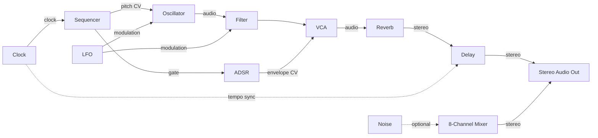

# Modular Synth Playground

**Patch. Modulate. Perform.**

Turn your browser into a hands-on, Eurorack-inspired synthesizer. Connect
oscillators, control signals, effects, and stereo mixers with virtual patch
cables, then shape a sequence into a playable arrangement. Start with a
ready-to-play patch or build your own signal path from the ground up.

Created by Rita Silva as a web-based companion to
[ritasilva.online](https://ritasilva.online/).


## Make a patch your own

- **Get started instantly.** Choose from six Auto Patch chains: Clocked Voice,
  Harmonic Phaser, Granular Drift, Metallic Fold, Stereo Mixer, and Harmonica.
  Each explores a different combination of sources, modulation, and stereo
  effects.
- **Explore Harmonica.** Hear all eight harmonics separately panned across the
  stereo mixer, playing an original E-minor sequence through the Spectral
  Phaser, Cloudy, reverb, and delay. Clock, Sample & Hold, and LFO signals add
  rhythmic modulation.
- **Patch by hand.** Connect color-coded ports to re-route audio and control
  signals across the rack.
- **Write evolving patterns.** Shape eight steps with pitch, gate length,
  probability, ratchet, and slide controls; choose a scale, direction, and clock
  division.
- **Arrange a song.** Add sequences to an ordered list, set the repeat count for
  each entry (1–99), reorder the list, and play it from the sequencer.
- **Save patterns for later.** Named user sequence presets persist in this
  browser. No account or cloud service is required.
- **Play in stereo.** Cloudy, reverb, delay, the eight-channel mixer, and Audio
  Out provide left/right audio connections.
- **See what you hear.** Follow channel and master level meters, plus the VCA's
  live waveform scope.
- **Perform on a phone.** Use the compact landscape performance view or switch
  back to the full rack.

Audio generation and processing run locally with the browser's Web Audio API
and AudioWorklet. No API keys, plugins, or backend service are needed.

## Explore the rack

The rack contains 19 modules for building a sound from the first clock pulse to
the final stereo output.

| Module | What you can do |
| --- | --- |
| **Clock** | Set tempo from 30–300 BPM, tap a tempo, run or stop, reset, and switch the main control between tempo, division (÷4, ÷2, ×1, ×2, ×4), swing (0–75%), and pulse width (5–95%). Provides master, divided, and pulse outputs plus an external clock input. |
| **8-Step Sequencer** | Edit eight steps in pitch, gate length, probability, ratchet, or slide mode. Set length, forward/backward/ping-pong/random direction, clock division, transpose, scale, and root; randomize or reset; save and select named presets; and build an ordered song with per-sequence repeats. |
| **ADSR Envelope** | Shape attack, decay, sustain, and release from a gate input; send the envelope to a control-voltage destination such as the VCA. |
| **LFO** | Create low-frequency modulation with adjustable rate and depth. |
| **Oscillator** | Tune frequency and select sine, sawtooth, square, or triangle waveforms; accept V/oct and FM inputs. |
| **Noise** | Choose white, pink, or brown noise and set its output level. |
| **Sample & Hold** | Sample a signal on clock pulses, then adjust input gain, offset, and slew. |
| **Wavefolder** | Add harmonics by adjusting fold amount and symmetry; view the transfer curve as you shape it. |
| **Ring Modulator** | Multiply two audio inputs and control the output level for metallic, sideband-rich tones. |
| **Attenuverter** | Scale or invert a CV signal and add a bipolar voltage offset. |
| **Harmonic Oscillator** | Build additive tones from eight controllable partials. Sweep the harmonic center and width, shape the balance with tilt, and patch individual partials, level CV inputs, or triangle/square/sawtooth and mix outputs. |
| **Cloudy** | Create stereo granular textures with freeze, position, grain size, pitch, input gain, density, texture, feedback, and blend. CV inputs can modulate freeze, trigger, position, size, pitch, and blend. |
| **Spectral Phaser** | Shape stereo audio with six all-pass stages and three moving resonant bands. Adjust rate, depth, resonance, feedback, mix, band levels and frequencies, five LFO shapes (sine, triangle, square, random, and sample & hold), tempo sync, sweep, phase, stereo width, and separate low/high modulation rates. |
| **Filter** | Select low-pass, band-pass, or high-pass filtering; adjust cutoff and resonance, with a CV input for modulation. |
| **VCA** | Control audio level with a CV input and monitor the signal on a live waveform scope. |
| **Reverb** | Choose Room, Hall, Plate, Spring, or Convolution character. Shape decay, pre-delay, mix, and a mode-specific character control; enable reverse reverb. Stereo L/R inputs and outputs are provided. |
| **Delay** | Choose basic or ping-pong delay, adjust feedback and mix, and set time manually or sync it to the clock. Ping-pong mode offers clock divisions from 1/1 to 1/16. Stereo L/R inputs and outputs are provided. |
| **8-Channel Mixer** | Blend eight audio sources with individual level and pan controls, live channel meters, and stereo L/R mix outputs. |
| **Audio Out** | Set master level, monitor output level, and connect the stereo left and right inputs. |

The Convolution reverb mode generates its impulse response in the app; loading
external impulse-response files is not currently supported.

## How patching works

The rack is patch-driven: connecting ports changes the Web Audio graph. The
default patch is a quick way to hear the main voice, while the other modules
can be added by connecting their audio and CV ports.



`RackContainer` owns module state, the typed cable model, and the Web Audio
graph. React components render the module panels; audio nodes and the two
AudioWorklet processors handle synthesis and processing.

## Start playing

1. Choose a sound chain from the **Auto Patch preset** menu. Selecting one
   loads its signal path; the **Auto Patch** button reapplies the selected
   chain. Browsers require a user gesture before audio can start.
2. Turn the knobs, change the filter or effect modes, and adjust the sequencer.
3. To create a patch, click an output port and then a compatible input port.
   Click a connected port to remove its cable.
4. Choose **Clear All** to disconnect the current patch, or select an Auto
   Patch preset to explore another signal chain.
5. To build a song, save or load a sequence, choose **Add Current**, set each
   entry's repeat count, arrange the order, then choose **Play Song**.

Saved sequence presets use this browser's `localStorage` and remain available
after a refresh. The song arrangement is currently held in the page session and
does not persist after a refresh.

On phones, rotate to landscape to use the compact performance view. Choose
**Back to Performance View** to return to it from the full rack. Portrait mode
prompts you to rotate. Start with a comfortable device volume before raising
the master level.

## Run locally

### Requirements

- [Node.js](https://nodejs.org/) **20.9 or later**
- npm (included with Node.js)
- A modern browser with Web Audio API and AudioWorklet support

### Install and start

```bash
git clone https://github.com/ritaamaralsilva/playground.git
cd playground
npm ci
npm run dev
```

Open [http://localhost:3000](http://localhost:3000), choose an Auto Patch
preset, or connect a port to initialize audio.

### Production build

```bash
npm run build
npm start
```

The production server is available at [http://localhost:3000](http://localhost:3000).

### Quality checks

```bash
npm run lint
npm run build
```

## Built with

- [Next.js](https://nextjs.org/) App Router
- [React](https://react.dev/) and TypeScript
- [Tailwind CSS](https://tailwindcss.com/)
- Web Audio API, AudioWorklet, and browser-local storage for user sequence presets

## Project layout

```text
src/
├── app/                  # Next.js page, layout, and global styles
└── components/
    ├── eurorack/         # Rack composition, patch state, and audio graph
    ├── modules/          # Clock, sequencer, synth, effects, and mixer panels
    ├── ui/               # Shared knobs, ports, meters, and display components
    └── engine/           # Audio helpers, port types, clock, and sequencer logic
public/
└── worklets/             # Granular looper and spectral phaser processors
```

## License

Copyright © Rita Silva. All rights reserved.

The Cloudy panel layout is adapted from Mutable Instruments Clouds by Emilie
Gillet and is licensed under [CC BY-SA 3.0](https://creativecommons.org/licenses/by-sa/3.0/).
This adaptation is renamed Cloudy, uses this project's pastel styling, and
provides stereo audio ports and controls implemented by its granular processor.
This notice applies to the Cloudy panel layout; the rest of the project retains
the license stated above.
