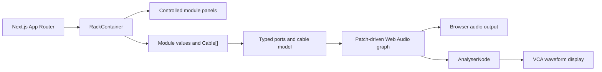
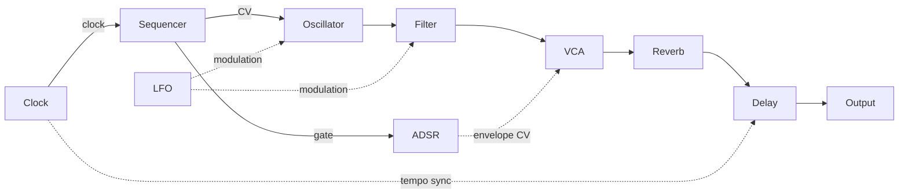

# Modular Synth Playground

**Patch. Modulate. Listen.**

An interactive, Eurorack-inspired synthesizer that turns your browser into a
small modular instrument. Connect audio and control-voltage ports, shape a
five-step sequencer, and hear the patch through the browser's native Web Audio
engine.

Created by Rita Silva as a web-based companion to
[ritasilva.online](https://ritasilva.online/).


## What you can do

- Build a patch by connecting digital CV ports, or start with **Auto Patch**.
- Sequence five notes and quantize them to a musical scale and root note.
- Shape pitch, tone, and amplitude with an LFO, filter, and ADSR envelope.
- Explore Buchla-inspired noise, ring modulation, sample-and-hold, wavefolding,
  harmonic synthesis, and CV processing.
- Mix four audio channels or capture a rolling four-second buffer for granular
  texture, feedback, and freeze effects.
- Add convolution reverb and tempo-synced or ping-pong delay.
- Shape audio with an original HM-2-inspired spectral phaser, featuring moving
  resonant bands, independent low/high modulation rates, feedback, and stereo
  offset.
- Watch the output waveform while you play.
- Use the full rack on desktop and landscape phones, with an optional compact
  performance view on mobile.

## Architecture

The app uses a **rack-orchestrated, patch-driven Web Audio architecture**.
`RackContainer` is the composition root: it owns module values, the typed cable
state, and the browser `AudioContext`. Dedicated React module components render
controlled front panels and send user changes back through typed props and
handlers. The rack translates the patch into Web Audio node connections.



### Signal flow

The Auto Patch preset demonstrates the main audio path and its control
connections. You can change the routing by repatching the ports.



## Modules

| Module                  | What it does                                                                                                                     | Main connections                                                                                                             |
| ----------------------- | -------------------------------------------------------------------------------------------------------------------------------- | ---------------------------------------------------------------------------------------------------------------------------- |
| **Clock**               | Sets tempo and provides the timing pulse.                                                                                        | Clock out to sequencer clock and delay clock.                                                                                |
| **5-Step Sequencer**    | Plays five editable notes, quantized by the selected scale and root.                                                             | Clock in; CV out to oscillator pitch; gate out to ADSR.                                                                      |
| **ADSR**                | Shapes the amplitude envelope with attack, decay, and release times plus a sustain-level control.                                | Gate in; envelope out to VCA CV.                                                                                             |
| **LFO**                 | Generates a low-frequency modulation signal with adjustable rate and depth.                                                      | Out to filter CV and/or oscillator FM.                                                                                       |
| **Oscillator**          | Generates sine, sawtooth, square, or triangle audio at an adjustable frequency.                                                  | V/oct and FM inputs; audio out.                                                                                              |
| **Filter**              | Selects low-pass, band-pass, or high-pass filtering with adjustable cutoff and resonance.                                        | Audio in/out; CV input for modulation.                                                                                       |
| **VCA**                 | Controls audio level and can be shaped by the ADSR envelope. Includes the waveform display.                                      | Audio in/out; CV in.                                                                                                         |
| **Reverb**              | Adds convolution reverb with adjustable size and wet mix.                                                                        | Audio in/out.                                                                                                                |
| **Delay**               | Adds feedback delay, with basic and ping-pong modes and clock synchronization.                                                   | Audio in/out; optional clock input.                                                                                          |
| **Noise**               | Selects white, pink, or brown noise and controls output gain with a dB readout.                                                  | Audio out.                                                                                                                   |
| **Ring Modulator**      | Multiplies two audio signals to create sum-and-difference sidebands, with adjustable output gain.                                | A/B audio inputs; audio out.                                                                                                 |
| **S&H**                 | Samples an input on each clock pulse, with input gain, offset, and slew controls.                                                | Signal and clock in; CV out.                                                                                                 |
| **Wavefolder**          | Folds an input waveform with adjustable fold amount and symmetry for additive harmonics.                                         | Audio in/out.                                                                                                                |
| **Attenuverter**        | Scales or inverts a signal and adds a bipolar offset.                                                                            | CV in/out.                                                                                                                   |
| **Harmonic Oscillator** | Eight-partial additive oscillator with harmonic center/width sweep, balance tilt, per-partial levels, and linear/exponential FM. | V/oct, linear/exponential FM, center/width CV, eight level CV inputs; eight sine outputs, three core waveforms, and mix out. |
| **8-Channel Mixer**     | Combines eight audio signals and displays a live dB meter for each channel.                                                      | Eight audio inputs; mix out.                                                                                                 |
| **Cloudy**              | Granular processor with position, size, pitch, input gain, density, texture, feedback, blend, and freeze controls.               | Audio in/out; CV inputs for freeze, trigger, position, size, pitch, and blend.                                               |
| **Spectral Phaser**     | Six-stage all-pass phaser interleaved with three moving resonant bands inspired by the HM-2's tonal character.                   | Audio in/out; CV inputs for rate, depth, resonance, feedback, mix, bands, sweep, and low/high modulation rates.              |
| **Output**              | Sets master volume, shows a live dB meter, and indicates whether the output port is connected.                                   | Final audio input.                                                                                                           |

## Try it

1. Select **Auto Patch** to connect a playable example and initialize browser
   audio. Browsers require a user gesture before audio can start.
2. Adjust the knobs, choose a filter type, or change the sequencer scale and
   root.
3. To build your own patch, click an unused port, then click a port of the
   opposite type. Click a connected port to remove its cable.
4. Select **Clear All** to disconnect the patch.

On mobile devices, rotate to landscape to use the full rack; choose **Back to
Performance View** for the compact view. Portrait orientation displays a prompt
to rotate. Start with a comfortable device volume before raising the master
level.

## Run locally

### Requirements

- [Node.js](https://nodejs.org/) **20.9 or later**
- npm (included with Node.js)
- A modern browser with Web Audio API support
- AudioWorklet support for the Cloudy and Spectral Phaser modules

### Clone and install

```bash
git clone https://github.com/ritaamaralsilva/playground.git
cd playground
npm ci
```

### Start the development server

```bash
npm run dev
```

Open [http://localhost:3000](http://localhost:3000), then select **Auto
Patch** or connect a port to enable audio. No API keys or environment
variables are required.

### Build and run for production

```bash
npm run build
npm start
```

The production server is available at [http://localhost:3000](http://localhost:3000).

### Quality checks

```bash
npm run lint
npm run build
```

## Project layout

```text
src/
├── app/                  # Next.js App Router page, layout, and global styles
├── components/
│   ├── eurorack/         # RackContainer: patch state and audio graph
│   ├── modules/          # Controlled module front panels
│   ├── ui/               # Shared knobs, ports, displays, and panel UI
│   └── engine/           # Port and cable types, definitions, constants, helpers
└── global.d.ts           # CSS module declaration for TypeScript
```

## License

Copyright © Rita Silva. All rights reserved.

The Cloudy panel layout is adapted from Mutable Instruments Clouds by Emilie
Gillet and is licensed under [CC BY-SA 3.0](https://creativecommons.org/licenses/by-sa/3.0/).
This adaptation is renamed Cloudy, uses this project's pastel styling, and
simplifies the interface to the controls and mono ports supported by its audio
engine. This notice applies to the Cloudy panel layout; the rest of the project
retains the license stated above.
